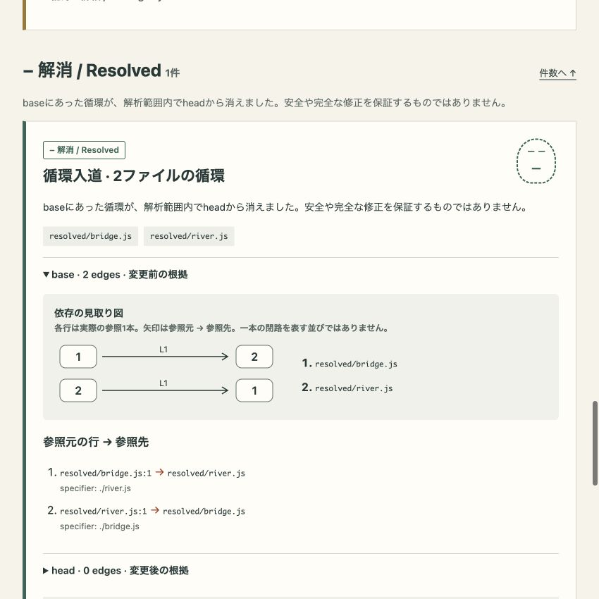
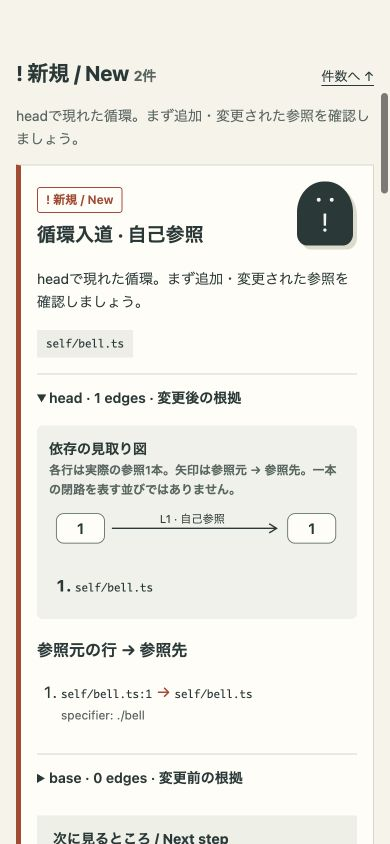

# Issue #5 experience validation

The HTML presentation changes only; analyzer rules, JSON schema, finding keys, evidence and coverage semantics are unchanged. All screenshots contain fictional fixtures only. No dependencies, external assets, scripts, paid APIs or deployment were added.

## Reproduce

From the repository root (Node.js 22+):

```sh
npm run build
node test/experience-preview.mjs reports/experience-review
python3 -m http.server 14345 --bind 127.0.0.1 --directory reports
```

Use a fresh output directory each time; reports are never overwritten. The generator creates temporary fictional sources, invokes the real CLI and removes those sources. Existing `fixtures/demo` and `fixtures/zero` are reused. Other fixtures include a branched three-file SCC with a long filename and an ampersand, a nine-file SCC, and a self-cycle that becomes unresolved because head contains a syntax error. The last fixture must exit 2; the others exit 0.

Open `http://127.0.0.1:14345/experience-review/demo/report.html`; replace `demo` with `zero`, `long`, `large` or `partial`. Choose another port if occupied. The session used `reports/experience-final` and port 14345. Port 14335 was occupied and was left alone.

## Observed behavior

- Demo retains new=2, continuing=1, resolved=1. Its generated JSON is byte-identical to the pre-change demo JSON.
- Count links move to new, continuing and resolved sections. Return links lead back to counts. Keys are hidden in native details; permalink IDs derive from the complete key, and ordering is deterministic within each status.
- Every diagram row corresponds to a real edge and shows its source line and file numbers. Self-reference is explicitly marked. The branched SCC shows four real edges, not an invented three-node ring. Repeated imports remain separate evidence rows.
- New/continuing open head initially. Continuing can expand base alongside head. Resolved opens base first, shows old evidence, and describes head as undetected within scope. The head details explain that this does not assert all files/references disappeared.
- The nine-file SCC shows the 8-file/12-edge diagram limit and all nine textual edges. Automated tests also verify both sides of the 8/9 file and 12/13 edge limits.
- Zero findings retain a clear no-safety-guarantee message. The partial fixture has a top-level warning, a local warning beside the resolved finding, and a coverage link to `bell.ts:2` (parse error).
- Actual viewports were 1280×800, 850×850 and 390×844. Demo, zero, long, large and partial all had `documentElement.scrollWidth === innerWidth`; all 15 measurements are in [viewport-checks.json](screenshots/issue-5/viewport-checks.json). Long paths wrap without shortening the evidence.
- Enter activates count links and native details. The focused summary has a visible 3px blue outline. Opening finding-key details works on mobile. No animation or smooth scrolling is introduced, so there is no motion to disable for reduced-motion users; OS/browser preferences were not changed.
- Browser DOM has no scripts or external resource elements. CSP retains `default-src 'none'`, inline styles only, `base-uri 'none'` and `form-action 'none'`. SVG contains only inline geometry/text. HTML injection tests cover SVG titles, long hostile paths and parser notices. Browser inspection is DOM/visual validation, not a network packet capture.

## Before / after

Before images were captured from the existing demo before implementation; after images use the final fictional demo. Viewport screenshots are unedited.

| Viewport | Before | After |
| --- | --- | --- |
| 1280×800 | [Before](screenshots/issue-5/before-1280.png) | [After](screenshots/issue-5/after-1280.png) |
| 850×850 | [Before](screenshots/issue-5/before-850.png) | [After](screenshots/issue-5/after-850.png) |
| 390×844 | [Before](screenshots/issue-5/before-390.png) | [After](screenshots/issue-5/after-390.png) |

Resolved evidence opens on base:



Self-reference and source evidence on mobile:



Boundary screenshots: [long paths](screenshots/issue-5/long-390.png), [large SCC](screenshots/issue-5/large-390.png), [partial coverage](screenshots/issue-5/partial-390.png), [keyboard focus](screenshots/issue-5/after-resolved-focus-850.png).

## Verification limits

The actual browser rejects `file://` navigation by policy. Direct file/offline browser execution is therefore **unverified**; no alternate browser or bypass was used. Loopback HTTP rendering, script-free native controls, inline SVG/CSS and restrictive CSP were verified. Cross-browser/screen-reader, Windows and native mobile-device testing were not performed. Viewport checks are desktop browser emulation. Existing unsupported resolution and coverage limitations still apply. No independent analyzer defect was found within this work.

Local checks passed on macOS / Node.js v25.4.0 / npm 11.7.0: 26 tests, typecheck, build and diff whitespace check. Latest-head hosted Ubuntu/Node.js 22 CI and pinned-analyzer reporting results are recorded in the PR checks and PR description after push. The reporting workflow intentionally uses its existing pinned analyzer, while development CI builds this PR's renderer.
